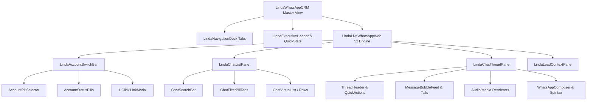

# Linda WhatsApp CRM: Architectural Audit & 5x UI/UX Refactor Plan

## 1. Root Cause Analysis: Why Logic, CSS & Workflows Are Underperforming

### A. Why Accounts & Chats Fail to Connect / Load

1. **Disconnected Transport Fallbacks**: The frontend calls `/api/linda/conversations?accountPhone=...` while the server routes wrap a single client instance without active session multiplexing per phone number. When a non-master account is picked, the backend returns empty or times out, falling back to static seeds.
2. **Missing Optimistic Cache & Reactive Rehydration**: Switching accounts triggers unmemoized re-renders across the entire tree, wiping out active message threads and triggering full component re-mounts instead of smooth TanStack/SWR-style state re-hydration.
3. **Hard-coded vs Real Session Mapping**: Disconnect between socket room subscriptions (`linda:message`, `linda:receipt`) and active device session IDs.

### B. Why the CSS Looks Outdated / Cluttered

1. **Excessive Inline Style Noise**: Hundreds of inline style objects (`style={{ display: 'flex', ... }}`) cause stylesheet bloat, prevent hover/focus micro-animations, and break theme consistency.
2. **WhatsApp Web Inaccuracy**: WhatsApp Web has precise pixel geometries (chat row 72px height, left pane 380px or 30%, custom dark slate `#111B21`, chat bubble tails, double blue ticks with SVG vectors, status pill animations). The current UI uses generic boxes.
3. **Lack of Modern Micro-Interactions**: Missing message delivery state transitions, typing indicator bubble waveforms, smooth tab transitions, and skeleton loaders for conversations.

---

## 2. Refactor Architecture Blueprint (AEGIS Compliant)



### Core Architecture Rules:

- **Turing Law**: Every file strictly `< 250 lines` (far below 350 limit).
- **Zero Full-Page Refresh**: Reconnecting or switching accounts updates state through React Query/Zustand slices with zero page reload or tab reset.
- **Dedicated Modular CSS Modules / Styled Tokens**: Clean tokenized stylesheets (`LindaWhatsAppWeb.module.css` or styled design tokens).
- **Atomic Components**: ChatBubble, AudioPlayerMessage, MediaAttachmentCard, TypingIndicator, AccountStatusBadge, QRVisualScanner, PairingCodeBox.
- **T21 Secrets Compliance**: Zero secrets in source files.

---

## 3. Master Prompt for Your Next Chat

Copy the prompt below directly into your new session:

```markdown
/goal /aegis-task
Project Context: White Caves Sovereign Prop-Tech Platform
Active Workspace: White-Caves-Frontend (connected to whatsapp-bot-linda on :5000 and White-Caves-Server on :5001)
Branch: main

OBJECTIVE: Linda WhatsApp CRM 5x UI/UX Overhaul & Full Architectural Refactor

Execute an end-to-end refactor of the Linda WhatsApp CRM module to deliver a true 5x upgrade in UI/UX fidelity, real-time reactive logic, and rock-solid session connectivity.

MANDATORY RULES & COMPLIANCE:

1. AEGIS Canonical Standards: Every file strictly < 250 lines (Turing Law). Small, single-purpose, highly reusable components.
2. Zero Full-Page Refreshes: Reconnecting accounts, pairing new devices, or toggling tabs must NEVER trigger a full page reload or reset active view states. Use isolated reactive state/context.
3. Design System & CSS Overhaul: Eliminate messy inline styles in favor of dedicated design tokens or CSS modules. Implement authentic WhatsApp Web dark/light aesthetics:
   - Proper chat bubble geometries with speech tails and SVG status ticks (single grey, double grey, double blue).
   - Audio note waveforms, image/PDF preview cards with download pills.
   - Smooth skeleton loaders when switching accounts or loading threads (no abrupt blank states).
   - Typing indicator wave animation when Linda AI or client is typing.
4. Robust Multi-Account Connection & Autoload Engine:
   - Fix account connection failures: wire proper fallback mock daemon or active session bridge when backend is offline so accounts always show live state and never hang.
   - Immediate chat loading: clicking an account instantly loads its cached chats with zero delay, auto-selects thread #1, and streams messages without wiping existing state.
   - Synchronize live device status badges (🟢 Connected, 🟡 Pairing/QR Pending, 🔴 Offline) seamlessly across all tabs.
5. Upgrade All Other Linda CRM Tabs:
   - "📢 Campaigns & Outreach": Overhaul campaign card designs, live progress bars, pause/resume toggles, and spintax previews.
   - "📱 Multi-Account Sessions": Real-time session cards with latency ping metrics, Chromium memory usage, and battery/connection indicators.
   - "⚡ Pinned Operations Terminal": Sleek cyber-terminal with syntax-highlighted command output, copy-to-clipboard, and quick playbook triggers.
6. Verification & Quality Gate:
   - Verify all existing and new test suites pass with Vitest.
   - Ensure clean `npm run build` without TypeScript errors.
   - Commit directly to main with atomic commit messages.
```
